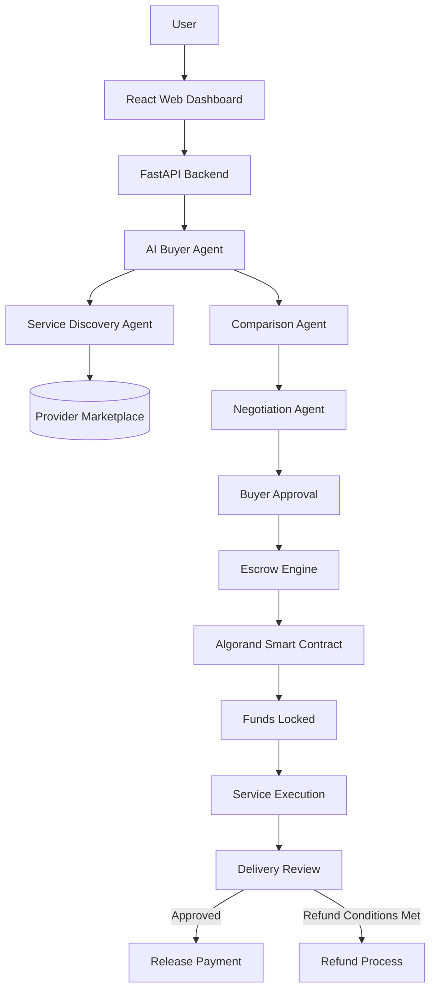
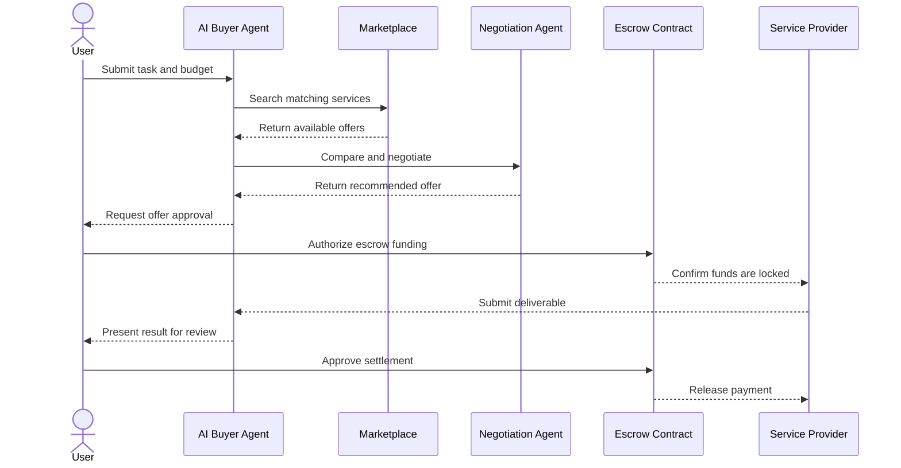

# 🤖 Aura Escrow Protocol
### Agentic Service Buyer — Autonomous AI Procurement with Secure Escrow

<p align="center">
  
</p>

<p align="center">
  <strong>Discover. Negotiate. Execute. Securely Settle.</strong>
</p>

<p align="center">
  
  
  
  
</p>

## 📌 Overview

**Aura Escrow Protocol** is an Agentic Service Buyer concept that combines AI agents, service discovery, price negotiation, and blockchain-based escrow to make digital service procurement more autonomous and secure.

A buyer describes a task, budget, and requirements. An AI buyer agent identifies suitable service providers, compares their offers, and recommends the best option. Once the buyer approves the transaction, the escrow mechanism can lock payment until the agreed service conditions are satisfied.

The goal is to reduce manual procurement work while increasing transparency, accountability, and trust between buyers and service providers.

## 🚨 Problem Statement

### The Trust Problem in Agentic Commerce

AI agents are increasingly capable of researching, coding, analyzing data, and completing digital tasks. However, allowing one autonomous agent to hire another creates important challenges.

- **Trust deficit:** A buyer cannot always verify a provider's reliability before paying.
- **Upfront payment risk:** A provider may receive payment without delivering the agreed service.
- **Uncertain delivery:** A buyer may receive incomplete or low-quality work.
- **Manual procurement:** Comparing providers, negotiating prices, and selecting services takes time.
- **Limited accountability:** Disagreements may lack a transparent, predefined resolution process.
- **Payment coordination:** Autonomous agents need a secure way to coordinate service delivery and payment.

### Core Problem

How can an AI buyer agent autonomously discover service providers, negotiate a fair price, select a suitable offer, and securely pay for a service while protecting both the buyer and the provider?

## 💡 Proposed Solution

Aura introduces an AI-assisted service procurement workflow with an escrow-based payment mechanism.

1. The user submits a service request and budget.
2. The buyer agent interprets the request and identifies suitable providers.
3. The comparison agent evaluates price, quality, availability, and reputation data.
4. A negotiation agent proposes a price within the user's budget.
5. The buyer selects or approves the offer.
6. The escrow mechanism locks the agreed funds.
7. The provider completes the task and submits the deliverable.
8. The buyer reviews the result, and payment is released according to the escrow rules.
9. If the applicable failure or refund conditions are met, the refund process can be initiated.

**Key idea:** AI handles discovery and negotiation, while the escrow mechanism governs the agreed payment conditions.

## 🖼️ Project Visuals

Add actual screenshots of your application to the `assets/` directory.

| AI Buyer Dashboard | Provider Comparison |
|---|---|
|  |  |
| Service requests and agent status | Compare offers, prices, and available providers |

| Negotiation Interface | Escrow Transaction |
|---|---|
|  |  |
| Proposed prices and counteroffers | Payment status and settlement details |

## 🏗️ System Architecture



### Architecture Components

| Component | Responsibility |
|---|---|
| React dashboard | Service requests, provider comparison, and transaction status |
| FastAPI backend | API endpoints, request validation, and agent orchestration |
| AI buyer agent | Understand the user's task and budget |
| Service discovery agent | Find providers matching task requirements |
| Comparison agent | Rank available offers using price and other available criteria |
| Negotiation agent | Generate offers and counteroffers within defined limits |
| Marketplace database | Store provider listings, service descriptions, and offer information |
| Escrow smart contract | Enforce the payment and settlement rules defined by the contract |
| Wallet integration | Allow users to authorize supported blockchain transactions |
| Algorand Indexer | Retrieve relevant on-chain data, when integrated |

*This diagram describes the intended architecture. Confirm each component against the actual implementation before presenting it as completed functionality.*

## 🔄 How the Agentic Service Buyer Works



## 🧠 Multi-Agent AI Design

Aura can use specialized agents instead of relying on a single AI agent for the entire procurement process.

### 1. Buyer Agent
- Understands the user's request.
- Extracts task requirements, budget, and deadlines.
- Coordinates the procurement workflow.

### 2. Service Discovery Agent
- Searches the service marketplace.
- Filters providers by capabilities and availability.
- Returns relevant offers.

### 3. Comparison Agent
- Compares prices and delivery estimates.
- Evaluates available quality and reputation data.
- Ranks providers against the user's requirements.

### 4. Negotiation Agent
- Proposes an initial offer.
- Generates counteroffers within the budget.
- Applies minimum-price and maximum-budget constraints.
- Requests user approval before committing funds.

### 5. Escrow and Settlement Module
- Creates or references the relevant escrow transaction.
- Tracks funding and transaction status.
- Applies the contract's authorization and settlement rules.
- Supports refunds only under the implemented conditions.

## 💰 Example Use Case

Suppose a user wants a data analysis service with a maximum budget of ₹500.

| Provider | Offer | Delivery |
|---|---:|---|
| Provider A | ₹450 | 2 days |
| Provider B | ₹400 | 4 days |
| Provider C | ₹480 | 1 day |

The AI buyer agent compares the available offers using the user's requirements.

If the user prioritizes a balance of price and delivery time, Provider A may be recommended. The negotiation agent could propose ₹420, subject to the provider's acceptance and the application's negotiation rules.

Once an offer is approved, the escrow mechanism can hold the agreed payment until the required completion conditions are satisfied.

*These values are illustrative, not live marketplace offers.*

## 🛠️ Technology Stack

The intended stack for this project concept is:

| Layer | Technology |
|---|---|
| Frontend | React, Tailwind CSS |
| Backend API | Python, FastAPI |
| AI orchestration | Multi-agent workflow |
| AI model | Configurable language model API |
| Blockchain | Algorand |
| Smart contracts | Confirm the framework used in the repository |
| Wallet | Pera Wallet, if integrated |
| Blockchain data | Algorand Indexer, if integrated |
| Development environment | Algorand LocalNet, if configured |
| Marketplace data | Mock database or configured persistent database |

## 📂 Suggested Project Structure

```text
aura-escrow-protocal/
├── assets/
│   ├── aura-banner.png
│   ├── dashboard.png
│   ├── provider-comparison.png
│   ├── negotiation.png
│   └── escrow-transaction.png
├── frontend/
│   ├── src/
│   ├── public/
│   └── package.json
├── backend/
│   ├── agents/
│   │   ├── buyer_agent.py
│   │   ├── discovery_agent.py
│   │   ├── comparison_agent.py
│   │   └── negotiation_agent.py
│   ├── api/
│   ├── services/
│   └── main.py
├── contracts/
├── tests/
├── .env.example
├── .gitignore
└── README.md
```

*This is a suggested structure, not a verified listing of the repository's current files.*

## 🚀 Getting Started

### 1. Clone the repository

```bash
git clone https://github.com/Parthiv307/aura-escrow-protocal.git
cd aura-escrow-protocal
```

### 2. Inspect the project

```bash
git ls-files
```

Check the existing README, package manifests, backend requirements, and smart-contract configuration before choosing installation commands.

### 3. Configure the frontend

If the repository contains a React application with a `package.json`:

```bash
cd frontend
npm install
```

Start the frontend using the script defined in its `package.json`.

### 4. Configure the backend

If the repository contains a Python FastAPI backend:

```bash
cd backend
python -m venv .venv
```

On Windows:

```powershell
.venv\Scripts\Activate.ps1
```

Install dependencies using the project's actual `requirements.txt` or `pyproject.toml`, then start the application using its documented entry point.

### 5. Configure environment variables

Create a local `.env` file if the project requires one. Use the variable names documented by the implementation.

```env
# Example placeholders only
MODEL_API_KEY=
ALGOD_SERVER=
ALGOD_TOKEN=
```

Do not add private keys, wallet secrets, or real credentials to GitHub.

### 6. Test the application

Before deploying, test:

- Service discovery and offer comparison.
- Negotiation within the user's budget.
- User approval and escrow funding.
- Successful service delivery.
- Authorized payment release.
- Eligible refunds and failed transactions.
- Smart-contract authorization and invalid state transitions.

*Follow the actual project configuration if it differs from these illustrative steps.*

## 🔐 Security and Trust

- Require explicit authorization for transactions that spend funds.
- Enforce spending limits and budget constraints.
- Validate all agent outputs before executing transactions.
- Never let an AI model directly bypass smart-contract authorization.
- Restrict settlement operations to authorized participants.
- Protect against reentrancy and invalid state transitions where applicable.
- Use a test network before handling real funds.
- Treat AI recommendations as untrusted until validated.
- Keep secrets out of source control.

## 🗺️ Future Enhancements

- Reputation-based provider recommendations.
- Improved autonomous negotiation.
- Service quality verification.
- Dispute resolution and arbitration.
- Multi-agent task delegation.
- Transaction analytics and audit trails.
- Additional wallet and marketplace integrations.

## 🤝 Contributing

1. Fork the repository.
2. Create a feature branch.
3. Make your changes.
4. Test your changes.
5. Submit a pull request explaining the improvement.

## ⚠️ Disclaimer

This project description does not constitute a security audit. AI-generated decisions can be incorrect, and blockchain transactions may be irreversible. Review the smart contracts and transaction authorization flow before using real funds.

## 📄 License

Add the license that applies to the repository.

## 👨‍💻 Project

**Aura Escrow Protocol — Agentic Service Buyer**

anthor : devaraja 

---

<p align="center">
  <strong>Building the future of autonomous service procurement. 🤖🔐</strong>
</p>
<a> https://loaded-fixed-seal.flyingraccoon.tech/dashboard </a>
